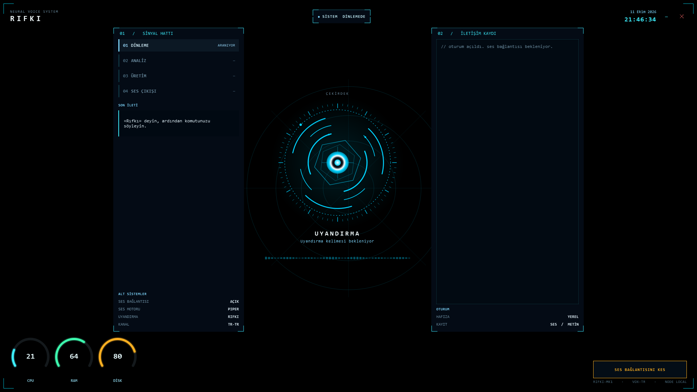

# RIFKI — Kişisel Masaüstü Yapay Zekâ Asistanı (Faz 1 / MVP)

Türkçe konuşan, sesli komutları anlayan, Google Gemini tabanlı bir
karar mekanizmasıyla bilgisayarında güvenli işlemler yapabilen, PyQt5
tabanlı futuristik arayüze sahip bir masaüstü asistanı.

Bu bir demo/prototip değil, gerçekten çalışan bir Python uygulamasıdır.
Ancak dürüstçe belirtmek gerekir: bazı bölümler (aşağıda "Faz 2" olarak
işaretlenenler) bilinçli olarak iskelet/TODO bırakıldı — sahte biçimde
"çalışıyormuş gibi" gösterilmedi.

## Ne Çalışıyor (Faz 1 — bu teslimat)

- ✅ Futuristik PyQt5 arayüzü (animasyonlu çekirdek, durum göstergesi, sohbet paneli, CPU/RAM, saat)
- ✅ Türkçe mikrofon girişi + Google Speech Recognition ile metne çevirme
- ✅ "Rıfkı" wake word döngüsü (bkz. sınırlamalar aşağıda)
- ✅ Gemini API ile tool-calling (function calling) tabanlı karar sistemi (core/ai.py)
- ✅ gTTS / pyttsx3 ile Türkçe sesli yanıt
- ✅ Temel sohbet + bağlam hafızası (kısa süreli)
- ✅ Uzun süreli hafıza (SQLite: "bunu hatırla" / "bunu unut")
- ✅ Uygulama açma/kapatma (bilinen uygulamalar listesi)
- ✅ Web sitesi / YouTube / Google arama açma
- ✅ İnternette bilgi arama (DuckDuckGo metin araması, API anahtarsız)
- ✅ Dosya arama / oluşturma / kopyalama / taşıma / yeniden adlandırma / silme
- ✅ Sistem bilgisi (CPU, RAM, disk), tarih-saat
- ✅ Ekran görüntüsü alma
- ✅ Ses seviyesi ayarlama (Windows + pycaw)
- ✅ Masaüstü bildirimi gönderme (Windows + win10toast)
- ✅ Kritik işlemler (kapatma, yeniden başlatma, dosya silme vb.) için onay sistemi
- ✅ Log sistemi (logs/rifki.log), her modülde çökme yerine sade hata mesajı
- ✅ Mobil köprü: telefondan durum izleme + metin komut (PWA + Cloudflare Tunnel)

## Mobil erişim (Play / APK)

Her kullanıcı kendi bilgisayarındaki RIFKI’ye bağlanır. Adres ve token elle
girilmez; QR ile eşleştirilir.

**Hazır paketler**

| Dosya | Ne için |
|-------|---------|
| [`mobile-android/RIFKI-mobile-release.aab`](mobile-android/RIFKI-mobile-release.aab) | Google Play yüklemesi (imzalı) |
| [`mobile-android/RIFKI-mobile-debug.apk`](mobile-android/RIFKI-mobile-debug.apk) | Yan test / doğrudan kurulum |

**Kullanım**

1. Bilgisayarda RIFKI’yi aç (token yoksa otomatik üretilir).
2. Tepsi simgesi → **Mobil bağlantı** → QR görünür.
   - Aynı Wi‑Fi: LAN QR
   - Uzaktan: pencereden tüneli aç (`tools/cloudflared.exe` gömülü)
3. Telefonda RIFKI → **QR tara** → bağlanır.
4. Ses PC’den çıkar; telefonda durum + metin komut.

Menüden **Yeniden eşleştir** / **Bağlantıyı kaldır** kullanılabilir.

**Play Store**

- Paket kimliği: `com.rifki.assistant` · sürüm `2.1.0`
- Gizlilik metni: [`docs/privacy-tr.md`](docs/privacy-tr.md) → GitHub Pages / sitenizde yayınlayıp URL’yi Console’a yapıştırın
- Mağaza taslağı: [`docs/play-listing-tr.md`](docs/play-listing-tr.md)
- Yayın checklist: [`docs/play-publish-checklist-tr.md`](docs/play-publish-checklist-tr.md)
- İmza: `mobile-android/keystore/create-keystore.ps1` (`.jks` git’e girmez)
- Yeniden derleme: `cd mobile-android` → `.\build-release.ps1` (JDK 17 gerekir)

## Kurulum (Windows) — Setup.exe

Son kullanıcı için tek dosya kurulum (TXT yok):

1. `dist\RIFKI` üret: `venv\Scripts\python.exe -m PyInstaller --noconfirm rifki.spec`
2. `cd installer` → `.\build-setup.ps1` (Inno Setup 6 gerekir)
3. Çıktı: `dist\RIFKI-Setup-2.1.0.exe`

Kurulum sihirbazı:

- OmniRoute nedir bilgilendirmesi
- `localhost:20128` kontrolü
- API anahtarı / model formu → `.env` otomatik yazılır
- `installer/payload/omniroute/` doluysa OmniRoute da kopyalanır

**OmniRoute:** RIFKI’nin yerel yapay zekâ köprüsü (`OMNIROUTE_*`). Kapalıysa uygulama açılır ama cevap veremez; ilk açılışta da ayar diyaloğu çıkar.  
Windows indirme: [OmniRoute v3.8.51](https://github.com/diegosouzapw/OmniRoute/releases/tag/v3.8.51) → `OmniRoute.Setup.3.8.51.exe`

Geliştirici (kaynak): Python 3.10+ ve aşağıdaki “Kurulum (geliştirici)” adımları.

## Faz 2'ye Bırakılanlar (şu an İSKELET / TODO — sahte çalışmıyor)

- ⏳ `tools/media.py`: Müzik/video çalma — sadece "henüz desteklenmiyor" mesajı döner.
- ⏳ `tools/notifications.py -> set_reminder`: Gerçek zamanlayıcı yok, sadece loglar.
- ⏳ Gerçek offline wake-word motoru (Porcupine vb.) — şu an Google STT ile
  taklit ediliyor (bkz. `voice/wake_word.py` içindeki not, daha yüksek gecikme).
- ⏳ Eklenti sistemi (spotify.py, discord.py, github.py, calendar.py) — mimari
  buna hazır (`tools/` klasörüne yeni dosya + `core/router.py`'a şema eklemek
  yeterli) ama henüz yazılmadı.

## Gereken API Anahtarları

| Anahtar | Zorunlu mu? | Nereden alınır |
|---|---|---|
| `OMNIROUTE_API_KEY` | **Evet** | OmniRoute paneliniz (Setup formuna yapıştırılır) |
| `OMNIROUTE_MODEL` | Hayır | Varsayılan: `antigravity/gemini-2.5-flash` |

STT / TTS / web arama ayrı ücretli anahtar istemez (kişisel MVP).

## Kurulum (geliştirici)

1. Python 3.10+ kurulu olduğundan emin ol.
2. Proje klasöründe bir sanal ortam oluştur: