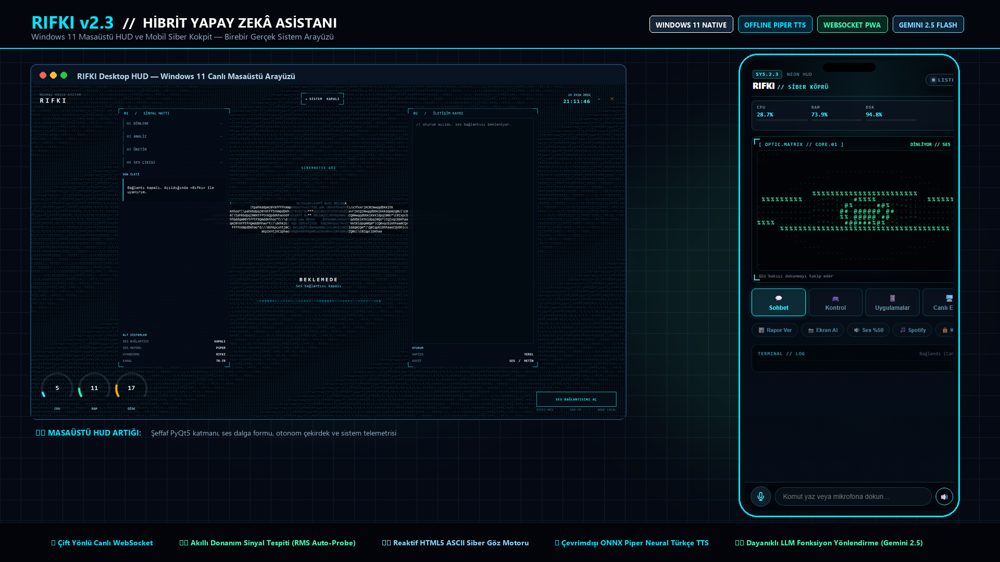
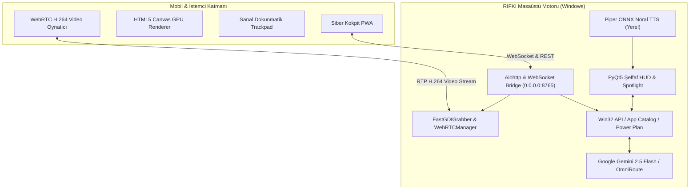

# RIFKI — Hibrit Masaüstü & Mobil Yapay Zekâ Asistanı (v2.7.1)

<p align="center">
  
</p>

<p align="center">
  <a href="https://github.com/BatuhanKlcky/rifki-voice-assistant/releases/latest"></a>
  <a href="https://www.python.org/"></a>
  
  
  <a href="https://github.com/BatuhanKlcky/rifki-voice-assistant/releases"></a>
</p>

Türkçe konuşan, sesli ve klavye komutlarını anlayan, Google Gemini tabanlı otonom karar mekanizmasıyla Windows işletim sisteminizi yöneten; PyQt5 tabanlı şeffaf masaüstü HUD'a ve telefonunuzdan sıfır gecikmeyle masaüstünü izleyip yönetmenizi sağlayan Siber Kokpit (PWA) arayüzüne sahip yeni nesil kişisel asistan.

---

## 🚀 Yeni Nesil Özellikler (v2.7.1)

### 🖥️ Donanımsal Canlı Ekran & Ultra-Düşük Gecikme (~10ms)
- **🚀 WebRTC H.264 Akışı:** NVIDIA NVENC / AMD / Intel donanım hızlandırmalı video kodlaması (60 FPS, ~10ms gecikme, sıfır CPU yükü). Mobil cihazlarda tam otomatik oynatma (autoplay) ve One-Shot ICE candidate gathering entegrasyonu.
- **⚡ Turbo WS (Zero-Latency Binary WebSocket Stream):** Windows GDI StretchBlt & DIB doğrudan bellek okuması ile 30+ FPS ikili JPEG akışı. Sayfa açıldığı anda sıfır bekleme süresiyle garanti yayın.
- **🎨 HTML5 Canvas GPU Renderer:** `createImageBitmap()` motoru ile gelen kareler DOM gecikmesi olmaksızın doğrudan GPU dokusuna yazılır.
- **🖱️ Donanımsal Fare İmleci:** Canlı ekranda Windows sistem fare imlecinin konumu ve şekli canlı yayına birebir işlenir.

### 📱 Siber Kokpit & Dokunmatik Sanal Trackpad
- **Sanal Mouse & Laptop Touchpad:** Telefondan masaüstü faresini gecikmesiz yönetme. Tek parmak hareket, hassas tıklama, iki parmakla yumuşak dikey kaydırma (scroll) ve sağ tık.
- **Spotlight & Uygulama Kataloğu:** Bilgisayarınızda yüklü 500+ Windows programını telefondan arayıp tek dokunuşla başlatma.
- **Gerçek Zamanlı Donanım Telemetrisi:** CPU, RAM, Disk kullanımı, pil durumu ve ağ trafiğini anlık HUD göstergeleriyle izleme.
- **HTML5 Canvas ASCII Siber Göz:** Dokunmayı ve etkileşimi takip eden dinamik reaktif yapay zekâ reaktörü.

### 🎮 Oyun ve Yüksek Performans Modu
- **`set_game_mode` Motoru:** Windows Yüksek Performans güç planını otomatik devreye sokar.
- **Tek Tuşla RAM Temizliği:** 100+ arka plan işleminin working set (çalışma kümesi) belleğini temizleyerek anında gigabaytlarca RAM açar.
- **Sıfır Yük (Eco HUD):** Oyun esnasında RIFKI arayüzü GPU/CPU tüketimini minimuma indirir.

### ⚡ Global Spotlight Hızlı Komut Çubuğu (`Ctrl + Space` / `Ctrl + Shift + R`)
- Hangi pencerede veya tam ekran uygulamada olursanız olun anında açılan Raycast / Spotlight benzeri komut merkezi.
- İster yazarak ister bas-konuş (Push-to-Talk) mikrofonu ile fısıldayarak komut verme.

### 🎵 Müzik & Medya Kontrolü
- *"YouTube Music'te Mor ve Ötesi çal"*, *"Arkaya lo-fi müzik aç"* dediğinizde en uygun parçayı bularak doğrudan tarayıcınızda veya masaüstünde başlatır.

### 🔌 Uzaktan PC Açma (Wake-on-LAN) & Sistem Otomasyonu
- Bilgisayarın fiziksel Ethernet/Wi-Fi MAC adresini tespit ederek yerel ağdaki cihazlara 102 baytlık Magic Packet gönderir.
- **Akıllı Klasör Düzenleyici:** İndirilenler klasöründeki dağınık dosyaları türlerine göre (`Resimler`, `Belgeler`, `Arşivler`, `Kurulumlar`) tek komutla toparlar.
- **Pencere & Sekme Yönetimi:** Masaüstünü gösterme (Win+D), pencere kapatma (Alt+F4), büyütme/küçültme, sekme açma/kapatma/kurtarma.
- **Güvenli Çöp Kutusu Boşaltma:** Onay mekanizmasıyla Windows Geri Dönüşüm Kutusunu temizler.

### 🔊 Çevrimdışı Türkçe Nöral Ses & Akıllı Mikrofon
- **Yerel Piper ONNX:** Bulut gecikmesi olmadan çalışan nöral Türkçe ses motoru (`tr_TR-fahrettin-medium`).
- **RMS Auto-Probe:** Windows'un sessiz "Stereo Karışımı" tuzağına düşmeden aktif kulaklık ve mikrofonu otomatik tespit eder.

---

## 🛠️ Mimari & Teknoloji Yığını



| Katman | Kullanılan Teknolojiler |
|---|---|
| **Yapay Zekâ Motoru** | Google Gemini 2.5 Flash / OmniRoute, Şema Tabanlı Otonom Tool Calling |
| **Görüntü & Canlı Akış** | WebRTC (`aiortc`), Win32 GDI DIB (`StretchBlt`), Turbo WS Binary JPEG, HTML5 Canvas |
| **Ses & Konuşma** | PyAudio (RMS Probe), SpeechRecognition, Piper ONNX Neural TTS |
| **Masaüstü Arayüzü** | PyQt5 (Şeffaf HUD), Win32 API (`RegisterHotKey`, `user32`, `shell32`, `psutil`) |
| **Mobil Köprü** | aiohttp, WebSockets, Responsive PWA, Touch Event Engine |
| **Veritabanı & Güvenlik** | SQLite (İki katmanlı semantik hafıza), Token Auth, IP Brute-Force Koruması |
| **Paketleme & Dağıtım** | PyInstaller (Early ONNX Hook), Inno Setup 6 (`RIFKI-Setup-2.7.1.exe`) |

---

## 📲 Mobil Siber Kokpite Bağlanma

Her kullanıcı kendi bilgisayarındaki RIFKI’ye bağlanır. Adres veya şifre elle girilmez; QR kod ile anında eşleşir.

1. Bilgisayarda RIFKI’yi çalıştırın.
2. Sistem tepsisi (sağ alt) simgesine sağ tıklayın → **Mobil Bağlantı** seçeneğine tıklayın.
3. Açılan ekrandaki QR kodunu telefonunuzun kamerasıyla tarayın:
   - **Aynı Wi-Fi Ağı:** Yerel ağ üzerinden sıfır gecikmeli bağlantı.
   - **Dış Ağdan Erişim:** Dahili Cloudflare Tunnel desteği ile dünyanın her yerinden güvenli erişim.
4. Açılan web uygulamasını tarayıcı menüsünden **"Ana Ekrana Ekle"** diyerek tam ekran PWA olarak kullanabilirsiniz.

---

## 💻 Kurulum (Windows)

### 1. Hazır Kurulum Sihirbazı (Önerilen)
En son sürüm olan **[RIFKI v2.7.1 Setup](https://github.com/BatuhanKlcky/rifki-voice-assistant/releases/latest)** dosyasını indirin ve çift tıklayarak kurulumu tamamlayın. Kurulum sihirbazı kısayolları ve gerekli bağımlılıkları otomatik olarak yapılandırır.

### 2. Geliştirici Kurulumu (Kaynak Koddan Çalıştırma)
1. Python 3.10+ kurulu olduğundan emin olun.
2. Projeyi klonlayın ve sanal ortam oluşturun:
   ```powershell
   git clone https://github.com/BatuhanKlcky/rifki-voice-assistant.git
   cd rifki-voice-assistant
   python -m venv venv
   .\venv\Scripts\activate
   pip install -r requirements.txt
   ```
3. `.env` dosyasını yapılandırın:
   ```env
   OMNIROUTE_API_KEY=your_gemini_key_here
   OMNIROUTE_MODEL=antigravity/gemini-2.5-flash
   WAKE_WORD=rıfkı
   TTS_ENGINE=piper
   PIPER_VOICE=tr_TR-fahrettin-medium
   MOBILE_BRIDGE_ENABLED=true
   MOBILE_BRIDGE_TOKEN=585858
   ```
4. Uygulamayı başlatın:
   ```powershell
   python main.py
   ```

---

## ⌨️ Temel Kısayollar

| Kısayol | Fonksiyon |
|---|---|
| **`Ctrl + Space`** veya **`Ctrl + Shift + R`** | Spotlight Hızlı Komut Çubuğunu açar/kapatır. |
| **`Esc`** | Açık olan Spotlight çubuğunu veya diyaloğu gizler. |
| **`Enter`** | Yazılı komutu asistana gönderir. |
| **`Mikrofon Simgesi (Uzun Basma)`** | Bas-Konuş (Push-to-Talk) sesli komut kaydını başlatır. |

---

## 📄 Lisans

Bu proje kişisel ve açık kaynaklı geliştirme amacıyla hazırlanmıştır. Katkıda bulunmaktan veya geri bildirim vermekten çekinmeyin!
